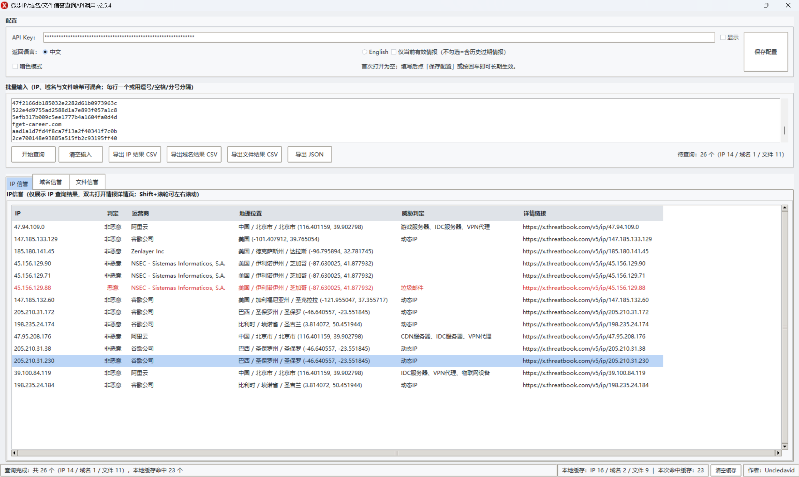
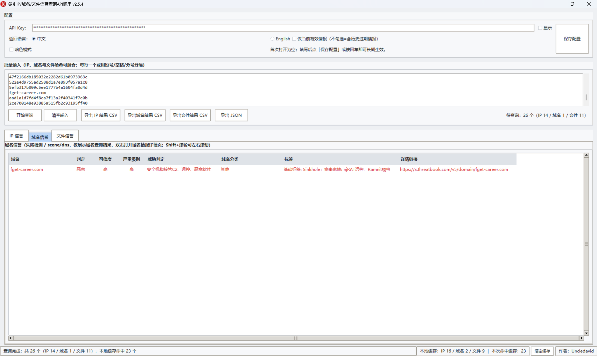
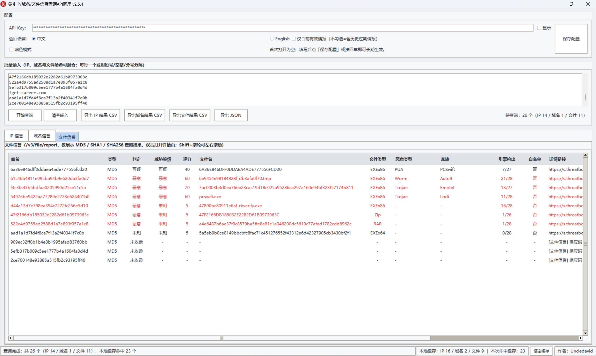
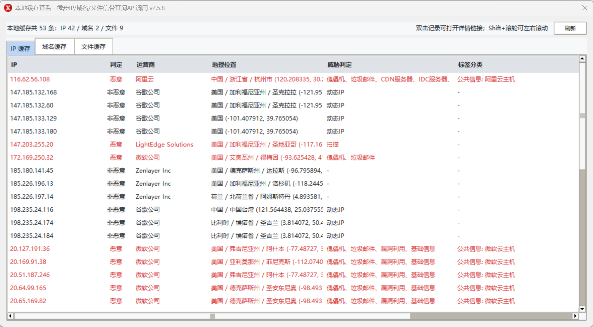

<div align="center">


# 微步IP/域名/文件信誉查询API调用

**Windows 桌面端 · 批量 IP / 域名 / 文件信誉查询工具**

基于微步在线 ThreatBook API 构建，支持本地缓存查看、暗色模式、IP / 域名 / 文件哈希混合查询与结果导出。

[](https://github.com/UncleBlog/threatbook-ip-domain-reputation/releases)
[](https://www.microsoft.com/windows)
[](https://www.python.org/)
[](LICENSE)

</div>

---

## 项目简介

这是一个面向安全运营、威胁情报分析和日常排查场景的 Windows GUI 工具。  
它把微步在线的 IP 信誉接口、失陷检测接口（`/v3/scene/dns`）与文件报告接口（`/v3/file/report`）整合到一个轻量界面中，支持 IP、域名与文件哈希混合批量查询，并把常用结果美化、缓存和导出。已查询过的 IP / 域名 / 文件哈希会直接读取本地缓存，避免重复消耗 API 额度；新增的本地缓存查看窗口可以按类型浏览全部缓存记录，也可以随时一键清空。配置模块也已精简，只保留 API Key 与暗色模式，减少无效选项带来的干扰。

> 默认不预置 API Key。首次启动为空，填写后点击「保存配置」即可长期生效。

## v2.6.3 升级亮点

- 适配 Windows 毛玻璃 / Acrylic 风格。
- 启用 Per-Monitor DPI V2。
- 优化高分屏字体清晰度。

## 界面预览

### IP 信誉查询



### 域名信誉查询



### 文件信誉查询



### 本地缓存查看



## 核心功能

| 功能 | 说明 |
|---|---|
| 🔍 IP / 域名 / 文件混合查询 | 自动识别 IP、域名、MD5、SHA1、SHA256，支持逗号、空格、分号或换行分隔 |
| ⚡ 本地结果缓存 | 已查询过的 IP / 域名 / 文件哈希直接读取本地缓存，避免重复消耗 API 额度 |
| 🗂️ 本地缓存查看 | 底部「查看缓存」打开独立窗口，按 IP / 域名 / 文件标签页列出全部本地缓存，可刷新并双击查看详情链接 |
| 🎯 信誉结果聚焦 | IP 仅展示 basic、is_malicious、judgments、tags_classes、permalink 等核心字段 |
| 🌐 域名失陷检测 | 调用 `/v3/scene/dns`，展示判定、可信度、严重级别、威胁类型、域名分类与标签 |
| 🧬 文件信誉查询 | 调用 `/v3/file/report`，支持 MD5 / SHA1 / SHA256，展示威胁等级、评分、文件名、类型、家族与引擎检出率 |
| 🔴 恶意标红 | 仅对恶意结果使用红色标注，非恶意结果保持清晰可读 |
| 🌙 暗色模式 | 深浅主题一键切换，并优化悬停与选中状态对比度 |
| 📊 批量导出 | 支持导出 IP 结果 CSV、域名结果 CSV 与 JSON |
| 🧹 缓存管理 | 底部状态栏常驻显示 IP / 域名 / 文件缓存数量与命中次数，清空缓存入口紧凑常驻 |
| 🧭 配置精简 | 删除返回语言、仅当前有效情报等臃肿配置，仅保留 API Key 与界面模式；语言固定中文，选项排列保持一致 |
| 🧾 中文错误码 | 微步 `response_code` 与常见 `verbose_msg` 自动转成中文，详情列更易读 |
| 🖥️ 单文件 EXE | 无需安装 Python，下载后直接运行 |

## 下载与运行

前往 [Releases](https://github.com/UncleBlog/threatbook-ip-domain-reputation/releases/latest) 下载：

```text
ThreatBookIPDomainFileReputation_v2.6.3.exe
```

运行环境：Windows 10 / 11。

## 快速开始

1. 打开程序，在「API Key」中填写你的微步在线 API Key。
2. 点击「保存配置」或按回车，Key 会保存到本机并持久生效。
3. 在输入框中批量粘贴 IP、域名、MD5、SHA1 或 SHA256，支持混合输入。
4. 点击「开始查询」。
5. 查询完成后可导出 CSV / JSON，或双击结果行打开情报详情页。

### 缓存位置

```text
%APPDATA%\ThreatBookIPReputation\cache.json
```

### 配置文件位置

```text
%APPDATA%\ThreatBookIPReputation\config.json
```

## API 说明

| 类型 | 接口 | 说明 |
|---|---|---|
| IP | `/v3/scene/ip_reputation` | IP 信誉查询，支持批量，单次建议不超过 100 个 |
| 域名 | `/v3/scene/dns` | 失陷检测（scene/dns），支持 IP / 域名混合批量，单次最多 100 个 |
| 文件 | `/v3/file/report` | 文件信誉查询，支持 MD5 / SHA1 / SHA256 单个哈希查询 |

> 域名侧展示 `is_malicious`、`confidence_level`、`severity`、`judgments`、`tags_classes`、`categories`、`permalink`。<br>
> 文件侧展示 `summary`、`multiengines` 与 `permalink`。<br>
> 接口需要在微步控制台为当前 API Key 开通对应权限，否则会返回权限错误。

## 从源码构建

```powershell
git clone https://github.com/UncleBlog/threatbook-ip-domain-reputation.git
cd threatbook-ip-domain-reputation

python -m pip install pyinstaller requests
python build\build_exe.py
```

构建完成后，exe 会输出到：

```text
outputs\微步IP域名文件信誉查询API调用_v<版本号>.exe
```

## 安全说明

- 程序不会在源码或 exe 中预置任何 API Key。
- API Key 仅保存在本机用户目录下。
- 请勿把 `%APPDATA%\ThreatBookIPReputation\config.json` 提交到公开仓库。
- 仓库中的 `.gitignore` 已排除本地运行配置与缓存。

## 项目结构

```text
.
├── build/
│   ├── app.py                         # 主程序源码
│   ├── build_exe.py                   # 版本化打包脚本
│   ├── ThreatBookIPReputation.spec    # PyInstaller 配置
│   ├── app.ico                        # 程序 / exe 图标
│   └── app.png                        # README 与界面资源
├── docs/
│   ├── screenshot.png                 # 界面预览（总览）
│   ├── screenshot-ip.png              # IP 信誉查询截图
│   ├── screenshot-domain.png          # 域名信誉查询截图
│   ├── screenshot-file.png            # 文件信誉查询截图
│   └── screenshot-cache-viewer.png     # 本地缓存查看截图
├── CHANGELOG.md
├── LICENSE
└── README.md
```

## 免责声明

本工具仅用于授权的安全研究、威胁情报分析与自有资产管理。  
使用微步在线 API 时，请遵守其服务条款与 API 使用规范。

---

<div align="center">

Made with ❤️ by **Uncledavid**

</div>
